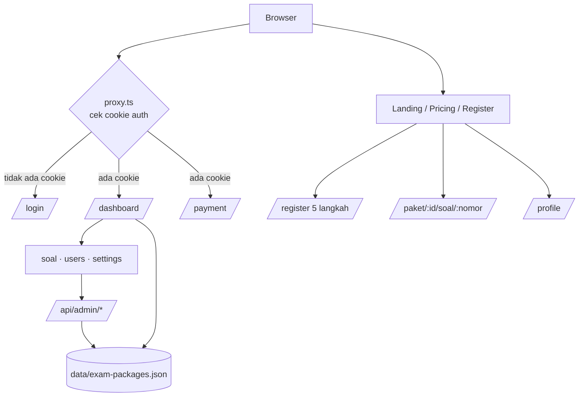
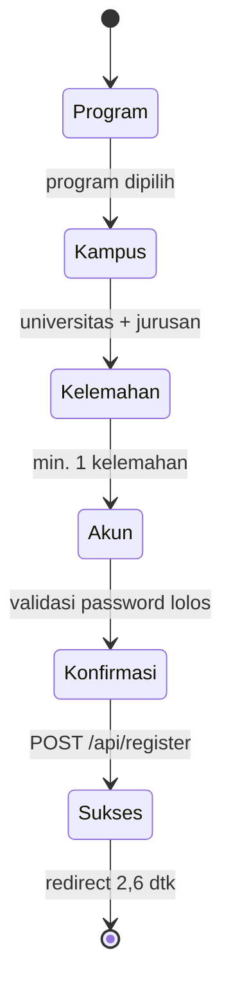
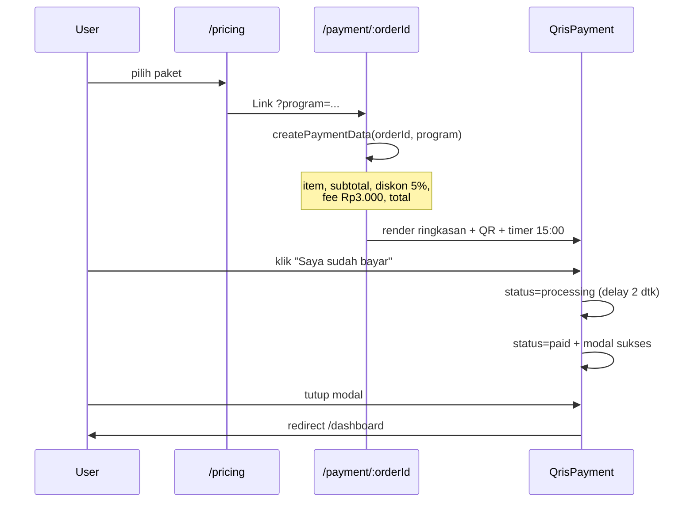
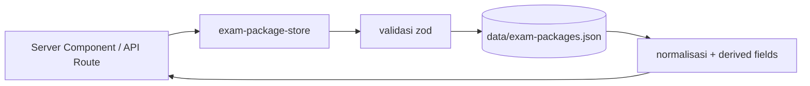

# Alur Kerja Aplikasi — raihlulus

Dokumen ini memetakan **bagaimana aplikasi berjalan saat ini**: rute, alur pengguna, alur data, kontrak API, serta bagian mana yang masih mock/tiruan. Diperbarui berdasarkan kondisi kode di branch `main`.

- **Produk**: platform tryout UTBK-SNBT (dan program lain: CPNS, BUMN, STAN)
- **Stack**: Next.js 16 (App Router) · React 19 · TypeScript · Tailwind v4 · shadcn/ui · zod · recharts · motion
- **Brand & metadata**: `lib/brand.ts`

---

## 1. Ringkasan Arsitektur

Aplikasi punya **tiga permukaan** yang berbagi satu proyek Next.js:

| Permukaan | Rute | Pengguna | Sumber data |
| --- | --- | --- | --- |
| Publik / marketing | `/`, `/pricing` | calon peserta | konten statis di komponen |
| Admin CMS | `/dashboard`, `/soal/*`, `/users`, `/settings` | admin/editor | JSON store + data statis |
| Siswa & ujian | `/profile`, `/paket/[id]/soal/[nomor]`, `/payment/[orderId]` | peserta | dummy / hardcoded |



---

## 2. Struktur Folder Penting

```
app/
  page.tsx                      # landing page
  layout.tsx                    # font, metadata, analytics
  globals.css                   # token warna (oklch) + Tailwind v4
  loading.tsx                   # loading global
  (auth)/login|register/        # route group autentikasi
  (pricing)/pricing/            # halaman harga
  (snbt)/paket/[id]/soal/[nomor] # pemain ujian (CBT)
  dashboard/                    # admin dashboard + loading skeleton
  payment/[orderId]/            # pembayaran QRIS
  profile/                      # dashboard siswa
  soal/input|list|packages/     # manajemen bank soal
  users/  settings/             # manajemen pengguna & pengaturan
components/
  particle/*                    # section landing page
  payment/*                     # order summary, QRIS, countdown
  profiles/*                    # widget dashboard siswa
  register/*                    # step wizard pendaftaran
  question-form.tsx             # form input soal
  sidebar.tsx  header.tsx       # shell admin
lib/
  exam-package-store.ts         # "database" JSON + validasi zod
  exam-package-catalog.ts       # katalog program & subtest
  brand.ts  utils.ts
data/
  exam-packages.json            # data paket (dibaca/tulis server)
  question-management.ts        # bank soal statis (mock)
  registerData.ts               # konten wizard (1.116 baris)
  registerExperience.ts         # copy + data kurva belajar
types/                          # exam-package, register, payment, dashboard
constants/paymentDummy.ts       # data pembayaran mock
hooks/useRegisterForm.ts        # state + submit wizard
proxy.ts                        # gate /dashboard & /payment
```

---

## 3. Peta Rute

| Rute | Tipe | Akses | Status data |
| --- | --- | --- | --- |
| `/` | client | publik | statis |
| `/pricing` | client | publik | statis (hardcoded) |
| `/login` | client | publik | mock (set cookie) |
| `/register` | client | publik | mock (API belum ada) |
| `/dashboard` | **server** | cookie auth | **nyata** (JSON store) |
| `/soal/input` | client | terbuka | mock (simpan palsu) |
| `/soal/list` | client | terbuka | statis |
| `/soal/packages` | **server** | terbuka | **nyata** (JSON store) |
| `/users` | client | terbuka | dummy |
| `/settings` | client | terbuka | dummy |
| `/profile` | client | terbuka | dummy |
| `/paket/[id]/soal/[nomor]` | client | terbuka | hardcoded |
| `/payment/[orderId]` | client | cookie auth | dummy |
| `/api/admin/packages` | route | terbuka | nyata |
| `/api/admin/packages/[id]` | route | terbuka | nyata |
| `/api/admin/subtests` | route | terbuka | nyata |

> Catatan: `proxy.ts` hanya mencocokkan `/dashboard/:path*` dan `/payment/:path*`. Rute admin lain **tidak** diproteksi.

---

## 4. Alur Pengguna

### 4.1 Pengunjung publik (landing → pricing)

1. Masuk ke `/` — `app/page.tsx` merangkai section: `Navbar → Hero → About → Methods → Leaderboard → Testimony → FAQ → Footer`.
2. Navbar (`components/particle/navbar.tsx`) mengarahkan ke:
   - **Beranda** → `/`
   - **Paket** → `/pricing`
   - **Dashboard** → `/profile` (dashboard siswa)
3. Di `/pricing` pengguna memilih tier harga; tombol membentuk URL
   `/payment/<orderId>?program=<snbt|cpns|bumn|stan>`.

### 4.2 Registrasi (wizard 5 langkah)

Berkas: `app/(auth)/register/page.tsx` + `components/register/*` + `hooks/useRegisterForm.ts`.



| Langkah | Komponen | Validasi |
| --- | --- | --- |
| 0. Program | `StepProgram` | wajib pilih 1 dari `PROGRAM_OPTIONS` |
| 1. Kampus/Jurusan | `StepJurusan` | pencarian + pilih universitas & jurusan |
| 2. Kelemahan | `StepKelemahan` | minimal 1 opsi dari `WEAKNESS_OPTIONS` |
| 3. Akun | `StepAkun` | nama, email, username, password + konfirmasi; skor kekuatan password |
| 4. Konfirmasi | `StepKonfirmasi` | ringkasan; submit |

- State wizard dikelola `useRegisterForm` (`step`, `direction`, `data`, `done`, `submitting`, `submitError`).
- `submit()` mengirim **`POST /api/register`** — **endpoint ini belum ada** di `app/api/`. Saat ini hasilnya akan gagal (404) lalu menampilkan `submitError`.
- Jika sukses: `SuccessScreen` tampil, lalu auto-redirect ke `/login`.
- **Dua taksonomi program**: wizard memakai `types/register.ts`
  (`utbk_snbt`, `kedinasan`, `pppk`, `tni_polri`, `luar_negeri`, ...),
  sedangkan CMS memakai `types/exam-package.ts` (`utbk`, `cpns`, `bumn`, `stan`).

### 4.3 Login & proteksi rute

```
POST-less login:
1. user isi email + password (validasi hanya "tidak kosong")
2. document.cookie = "rl_auth=1; path=/; max-age=<...>"
3. router.push(next ?? "/dashboard")
```

- `proxy.ts` membaca cookie `rl_auth | auth_token | token | session`. Jika ada yang terisi → lanjut; jika tidak → redirect ke `/login?next=<path>`.
- Tidak ada verifikasi kredensial, tidak ada session server, tidak ada role. Login = penanda lokal.

### 4.4 Pembelian paket → pembayaran QRIS

Berkas: `app/payment/[orderId]/page.tsx`, `components/payment/*`, `constants/paymentDummy.ts`.



- Nominal & item berasal dari `PROGRAM_ITEMS` di `constants/paymentDummy.ts`.
- Diskon **5%**, biaya layanan **Rp3.000**, countdown **15 menit** (`CountdownTimer`).
- Batal → `router.push("/pricing")`; sukses → `/dashboard`.
- Tidak ada integrasi payment gateway, tidak ada webhook, tidak ada pencatatan transaksi.

### 4.5 Mengerjakan tryout (CBT player)

Berkas: `app/(snbt)/paket/[id]/soal/[nomor]/page.tsx` (1.035 baris, client component).

- **Durasi**: 6.125 detik (hardcoded). Timer berjalan, mendekati habis → `handleAutoSubmit()` memunculkan dialog konfirmasi submit.
- **Soal**: 20 soal statis di dalam file (bukan dari `data/exam-packages.json`). `params.id` dan `params.nomor` hanya dipakai untuk URL.
- **Fitur UI**: navigasi soal (grid), tandai ragu/bookmark, panel pengaturan (suara, fullscreen), progress bar, pause.
- **Submit**: `handleSubmit()` → `window.location.assign("/")`. Tidak ada penyimpanan jawaban, tidak ada skoring, tidak ada halaman hasil.
- **Belum terhubung**: tombol dari `/soal/packages` maupun `/profile` tidak mengarah ke rute ini secara terstruktur.

### 4.6 Dashboard siswa (`/profile`)

- Client component dengan `DUMMY_DATA` di dalam file: user, IRT score, national rank, monthly stats, subtest, riwayat tryout, badge, next tryout.
- Membaca/menulis `localStorage["dashboardData"]`.
- Widget: `OverallSummary`, `MonthlyPerformance`, `SubtestAnalysis`, `TryoutHistory`, `StreakAchievement`, dengan `Sidebar` versi siswa.
- Tidak terhubung ke akun, hasil ujian, atau pembayaran.

### 4.7 Admin CMS

Shell: `Sidebar` (`w-64`, collapsible) + `Header` (`h-16`, notifikasi + menu profil). Main content `md:ml-64 pt-16`.

| Menu | Rute | Alur saat ini |
| --- | --- | --- |
| Dashboard | `/dashboard` | server component → `listExamPackages()`; hitung total soal, published, draft, archived; tampilkan `ActivityChart` & `UniversityChart` (data statis) |
| Input Soal Baru | `/soal/input` | `QuestionForm` (Program → Paket → Subtest → tingkat kesulitan → teks soal + opsi A–E). Simpan/Publish hanya `setTimeout` + toast; **tidak ada persistensi** |
| Daftar Soal | `/soal/list` | baca `MANAGED_QUESTIONS` statis; filter program/paket/subtest/kesulitan + pencarian; aksi edit/hapus belum berfungsi |
| Manajemen Paket | `/soal/packages` | server component → `listExamPackages()` + `listPrograms()`; tombol "Buat Paket" `disabled`; "Lihat Detail Paket" membuka JSON API |
| Manajemen Pengguna | `/users` | array user dummy; filter role; tombol tambah/hapus/edit belum berfungsi |
| Pengaturan | `/settings` | tab Umum/Keamanan/Notifikasi/Tampilan/Database; state lokal saja |

---

## 5. Alur Data

### 5.1 JSON store (`lib/exam-package-store.ts`)



- Lokasi file: `path.join(process.cwd(), "data", "exam-packages.json")`; direktori dibuat otomatis bila belum ada.
- Operasi: `listExamPackages(filter)`, `getExamPackageById`, `createExamPackage`, `updateExamPackage`, `deleteExamPackage`, plus helper katalog (`listPrograms`, `listSubtests`).
- Skema input (`createExamPackageInputSchema`):
  `title` 3–160, `description` 10–1200, `programId`, `status` (default `draft`), `difficultyProfile` (default `mixed`), `durationMinutes` 1–600, `year` 2020–2100, `tags` maks 12, `sections` min 1.
- Aturan tambahan: `subtestId` unik per paket, `questionIds` unik, `questionCount` konsisten.
- `runtime = "nodejs"` wajib di route API karena memakai `node:fs`.

### 5.2 Sumber data lain

| Sumber | Dipakai di | Sifat |
| --- | --- | --- |
| `data/exam-packages.json` | `/dashboard`, `/soal/packages`, API | persisten (file) |
| `data/question-management.ts` | `/soal/list`, `QuestionForm` | statis |
| soal di halaman ujian | `/paket/[id]/soal/[nomor]` | hardcoded |
| `constants/paymentDummy.ts` | `/payment` | statis |
| `DUMMY_DATA` + `localStorage` | `/profile` | dummy |
| array di komponen | `/users`, `/settings`, chart | dummy |

Artinya: **alur Program → Paket → Subtest sudah ada di level paket, tetapi bank soal dan soal ujian belum memakai sumber yang sama.**

---

## 6. Kontrak API

Base: `/api/admin` (belum ada autentikasi/otorisasi).

### `GET /api/admin/packages`
Query opsional: `status`, `programId`, `subtestId`.
```json
{ "data": [ /* ExamPackage[] */ ], "meta": { "total": 3 } }
```

### `POST /api/admin/packages`
Body sesuai `createExamPackageSchema`.
- `201` → `{ "message": "Paket soal berhasil dibuat.", "data": {...} }`
- `400` → `{ "message": "Payload paket soal tidak valid.", "errors": {...} }`

### `GET /api/admin/packages/:id`
- `200` → `{ "data": {...} }`
- `404` → `{ "message": "Paket soal tidak ditemukan." }`

### `PATCH /api/admin/packages/:id`
Body parsial; `400` bila tidak valid, `404` bila tidak ditemukan.

### `DELETE /api/admin/packages/:id`
Hapus paket; `404` bila tidak ditemukan.

### `GET /api/admin/subtests`
Query opsional: `programId`.
```json
{ "data": { "programs": [ /* ProgramDefinition[] */ ], "subtests": [ /* SubtestDefinition[] */ ] } }
```

### Endpoint yang **belum ada**
- `POST /api/register` (dipakai wizard)
- `POST /api/login`, `POST /api/logout`, `GET /api/session`
- `POST /api/payments`, `POST /api/payments/webhook`
- `POST /api/exam/:packageId/submit`, `GET /api/exam/:packageId/result`
- CRUD `/api/admin/questions`, `/api/admin/users`

---

## 7. State & Penyimpanan Klien

| Kunci | Lokasi | Ditulis oleh | Isi |
| --- | --- | --- | --- |
| `rl_auth` | cookie | `/login` | `"1"` penanda login |
| `dashboardData` | `localStorage` | `/profile` | data dashboard siswa (dummy) |
| step wizard | state React | `useRegisterForm` | progres 0–4 |
| timer ujian | state React | halaman ujian | sisa detik |
| timer pembayaran | state React | `CountdownTimer` | sisa detik |

---

## 8. Matriks Status Implementasi

| Fitur | UI | Logika | Persistensi | Keterangan |
| --- | --- | --- | --- | --- |
| Landing page | ✅ | ✅ | — | statis |
| Daftar harga | ✅ | ✅ | ❌ | hardcoded di file |
| Registrasi | ✅ | ⚠️ | ❌ | endpoint `/api/register` belum ada |
| Login | ✅ | ⚠️ | ⚠️ | hanya set cookie |
| Proteksi rute | ⚠️ | ⚠️ | — | cek keberadaan cookie saja |
| CRUD paket (API) | — | ✅ | ✅ | JSON file |
| Dashboard admin | ✅ | ✅ | ✅ | membaca store |
| Input/daftar soal | ✅ | ⚠️ | ❌ | mock/statis |
| Manajemen pengguna | ✅ | ❌ | ❌ | dummy |
| Pengaturan | ✅ | ❌ | ❌ | state lokal |
| Dashboard siswa | ✅ | ⚠️ | ⚠️ | dummy + localStorage |
| Pemain ujian | ✅ | ⚠️ | ❌ | soal & timer hardcoded |
| Pembayaran QRIS | ✅ | ⚠️ | ❌ | simulasi |

Legenda: ✅ berfungsi · ⚠️ sebagian/mock · ❌ belum ada

---

## 9. Kesenjangan & Rekomendasi Prioritas

1. **Autentikasi nyata** — buat `/api/register`, `/api/login`, `/api/logout`, session server (cookie httpOnly), lalu ganti cek cookie di `proxy.ts` dengan verifikasi sesi. Tambahkan role (`admin`, `editor`, `student`) dan lindungi `/soal/*`, `/users`, `/settings`, `/api/admin/*`.
2. **Satukan taksonomi program** — pilih satu sumber (`types/exam-package.ts`) dan petakan nilai wizard (`utbk_snbt` → `utbk`, dst.) agar registrasi dan CMS konsisten.
3. **Hubungkan bank soal ke paket** — jadikan `questionIds` di `exam-packages.json` merujuk soal nyata (tabel/collection), lalu buat `GET /api/exam/:packageId` untuk pemain ujian.
4. **Persistensi jawaban & skoring** — simpan jawaban per nomor, hitung skor, buat halaman hasil; hentikan `window.location.assign("/")` tanpa data.
5. **Payment gateway** — ganti `paymentDummy` dengan integrasi QRIS asli + webhook + tabel transaksi; jangan izinkan "sudah bayar" hanya dari klik klien.
6. **Rapikan dependensi** — `framer-motion` dipakai di banyak file tetapi tidak ada di `package.json` (hanya di lockfile). Standarkan ke `motion/react`.
7. **Matikan `ignoreBuildErrors`** secara bertahap agar error tipe tidak lolos build.
8. **Ganti JSON file store** dengan database (Postgres/SQLite) saat multi-user, karena penulisan file tidak aman untuk konkurensi di serverless.

---

## 10. Referensi Cepat

| Kebutuhan | Berkas |
| --- | --- |
| Ubah brand/nama/kontak | `lib/brand.ts` |
| Ubah warna & token desain | `app/globals.css` |
| Ubah menu admin | `components/sidebar.tsx` |
| Tambah field paket | `lib/exam-package-store.ts` + `types/exam-package.ts` |
| Tambah program/subtest | `lib/exam-package-catalog.ts` + `types/exam-package.ts` |
| Ubah konten wizard | `data/registerData.ts` |
| Ubah harga | `app/(pricing)/pricing/page.tsx` |
| Ubah item & nominal pembayaran | `constants/paymentDummy.ts` |
| Ubah soal ujian | `app/(snbt)/paket/[id]/soal/[nomor]/page.tsx` |
| Ubah gate rute | `proxy.ts` |
